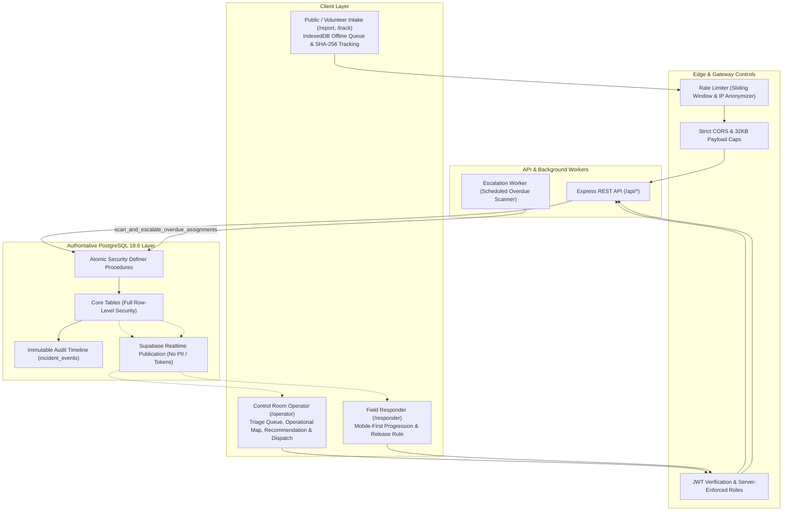

# Godavari Emergency Response Coordination System

A software-only hackathon prototype exploring reliable incident intake, operator triage, candidate team recommendation, missed-acknowledgement escalation, and public tracking for the Godavari Pushkaralu festival gathering.

> [!CAUTION]
> **HACKATHON PROTOTYPE — NOT AN EMERGENCY SERVICE**
> This site cannot request or guarantee help. It does not connect to police, fire, ambulances, hospitals, or government emergency dispatchers. For urgent life safety assistance during the festival, immediately call **112** from any telephone. All demonstration zones, teams, and incidents are synthetic fixtures.

---

## System Architecture



---

## Core Capabilities (Stages 1–12)

1. **Resilient Public Intake (`/report`):** Local IndexedDB queue (`godavari_emergency_queue_v1`) stores drafts on device, survives network drops, preserves original reported timestamps, handles stale drafts with user confirmation, and automatically reconciles lost server acknowledgements idempotently without duplicate records.
2. **SHA-256 Public Tracking (`/track`):** Unguessable 32-character hexadecimal tracking tokens hashed with SHA-256 before database storage. Lookup exposes approved public operational statuses while strictly redacting internal staff identities, responder radio channels, and callback details.
3. **Control Room Triage & Audit (`/operator`):** Real-time incident intake queue with live Realtime socket indicator, veracity indicators (manual selection vs GPS fix with accuracy circle and coordinate staleness), and priority triage.
4. **Candidate Team Dispatch:** Zone-based transparent suitability recommendation evaluating capabilities, duty status, and zone coverage. Atomic assignment locks records, sets configurable acknowledgement deadlines, and prevents double-booking.
5. **Missed-Acknowledgement Escalation:** Standalone Node.js background daemon (`EscalationWorker`) and PostgreSQL stored procedure detect active assignments past their deadline. Flags overdue assignments with one escalation event per timeout, activates operator visual alerts, and prevents browser timer dependency.
6. **Operator Reassignment Workflow:** Operator-controlled reassignment revokes previous team update rights, releases the previous team back to `ON_DUTY` per documented release rules, and assigns the replacement team atomically.
7. **Mobile-First Responder Workspace (`/responder`):** Single-task responder interface enforcing the strict sequential progression `ASSIGNED` → `ACKNOWLEDGED` → `EN_ROUTE` → `ON_SCENE` → `RESOLVED`. Handles idempotent repeat clicks, accepts support requests with mandatory notes, and marks resolution with documented availability release.
8. **Final Operator Closure:** Terminal transition to `CLOSED` restricted to operator roles, appending final audit closure history.
9. **Interactive Leaflet Mapping:** Offline-resilient operational map with OpenStreetMap tiles, fictional demo zones, distinct GPS vs manual markers, and graceful table fallback if tile servers fail.
10. **Bilingual Localization & Accessibility:** Complete English and Telugu (`తెలుగు`) localization with language switcher, prominent fluent-speaker review notice, high-contrast palette, visible `:focus-visible` focus rings, accessible `aria-describedby` field connections, and minimum 44px touch targets. Database enums remain standard English constants.
11. **Security Hardening:** In-memory sliding-window rate limiting (60 requests/10m) with SHA-256 IP anonymization, CORS origin restrictions, 32KB Express payload caps (HTTP 413), execution revocation from `PUBLIC`/`anon` on all database RPCs, and automated retention cleanup (`purge_expired_data`).
12. **End-to-End Verification:** 127 automated tests passing across contracts, API, and web, including an 11-step integration test and failure tests matrix.

---

## Quick Launch on Windows

You cannot run this website by simply double-clicking an `.html` file. Modern React applications require compilation, modules, and proxying that browsers block over the `file://` protocol.

To start the application on Windows:

1. **One-Click Launcher (Recommended):**
   - Double-click **`start-website.bat`** in the project root.
   - It checks Node.js and pnpm, builds shared contracts, starts Vite, and opens **`http://localhost:3000`** in your default browser.
   - To stop the server: return to the terminal and press `Ctrl+C`.

2. **Command Line (Terminal / PowerShell):**
   ```cmd
   # Start frontend only:
   pnpm dev:web

   # Start frontend and backend API together:
   pnpm dev
   ```
   Open your browser to `http://localhost:3000`.

---

## Fresh Local Setup

From the repository root on Windows, macOS, or Linux:

```sh
corepack enable
corepack prepare pnpm@11.25.0 --activate
pnpm install
cp apps/api/.env.example apps/api/.env
cp apps/web/.env.example apps/web/.env
pnpm dev
```

The Vite frontend listens on `http://localhost:3000`. The Express API listens on `http://localhost:4000`. Browser requests to `/api/*` are routed through Vite’s development proxy.

---

## Five-Minute Demonstration (3 Separate Sessions)

The prototype is verified across three separate browser windows or devices:

- **Session 1 (Volunteer Intake):** `http://localhost:3000/report` — Submit incident, copy tracking token, verify status on `/track`.
- **Session 2 (Control Room Operator):** `http://localhost:3000/staff/login` — Sign in with operator account, review incident, dispatch Team Alpha with 60-second prototype deadline. Observe overdue escalation badge when timeout occurs. Reassign to Team Bravo.
- **Session 3 (Field Responder):** `http://localhost:3000/staff/login` (in mobile emulation) — Sign in with responder account, acknowledge assignment, progress `EN_ROUTE` → `ON_SCENE`, and mark `RESOLVED`.
- Return to **Session 2** to close the case and view the immutable 11-step audit trail.

See [Five-Minute Demo Script](docs/demo-script.md) for detailed step-by-step instructions.

---

## Project Commands

```sh
pnpm dev             # Start frontend and API concurrently
pnpm dev:web         # Start only Vite development server
pnpm dev:api         # Start only Express API server
pnpm lint            # ESLint for TypeScript/React
pnpm format:check    # Check formatting with Prettier
pnpm format          # Apply Prettier formatting
pnpm typecheck       # Typecheck shared contracts, API, and frontend
pnpm test            # Run all 127 automated tests across all workspaces
pnpm db:smoke        # Execute PostgreSQL 18.6 embedded migration & E2E smoke tests
pnpm security:bundle # Scan production chunks for leaked secrets or tokens
pnpm check           # Full validation pipeline (lint, format, types, tests, builds, bundle scan)
pnpm health:check    # Query the local API health endpoint
node scripts/measurements.mjs  # Run empirical performance benchmarks
```

---

## Documentation Links

- [System Architecture](docs/architecture.md) — Subsystem boundaries, data flows, and Mermaid diagrams.
- [API Summary](docs/api-summary.md) — Complete endpoint reference, schemas, status codes, and rate limits.
- [Database Schema](docs/database-schema.md) — Tables, enums, RLS policies, and security definer procedures.
- [Comprehensive Test Report](docs/test-report.md) — Test breakdown, failure test matrix, and empirical benchmark measurements.
- [Security and Privacy Architecture](docs/security-and-privacy.md) — Threat model, token hashing, CORS, rate limiting, and retention policies.
- [Five-Minute Demo Script](docs/demo-script.md) — Multi-device demonstration walkthrough.
- [Deployment Checklist](docs/deployment-checklist.md) — Production hosting guide, environment variables, and process model.
- [Known Issues and Future Work](docs/known-issues.md) — Prototype limitations, single-team dispatch boundary, and future roadmap.
- [Build Progress](docs/build-progress.md) — Detailed chronological record of Stages 1 through 12.

---

## Routes Directory

| Route                  | Purpose                                                               | Access Level                        |
| :--------------------- | :-------------------------------------------------------------------- | :---------------------------------- |
| `/`                    | Prototype overview, safety warnings, and route navigation             | Public                              |
| `/report`              | Emergency report intake with IndexedDB local queue & GPS              | Public                              |
| `/track`               | Public status lookup using private SHA-256 tracking token             | Public                              |
| `/staff/login`         | Staff email/password authentication                                   | Public intake for provisioned staff |
| `/staff/accept-invite` | One-time administrator invitation password setup                      | Provisioned staff                   |
| `/operator`            | Operational triage, map, team dispatch, escalation alert, and closure | `OPERATOR`                          |
| `/responder`           | Mobile-first tactical assignment acknowledgement and progression      | `RESPONDER` (Active team only)      |
| `/admin`               | Staff provisioning, team membership, and non-secret config            | `ADMIN`                             |

---

## Prototype Boundaries and Ethical Disclaimers

This software is an educational and technological exploration designed for a hackathon challenge. It is not approved by government emergency services, does not interface with national emergency dispatch networks, and must never be relied upon for life safety during a real-world disaster or crowd emergency. In any active emergency, citizens and volunteers must use official emergency phone lines (**112** in India).
