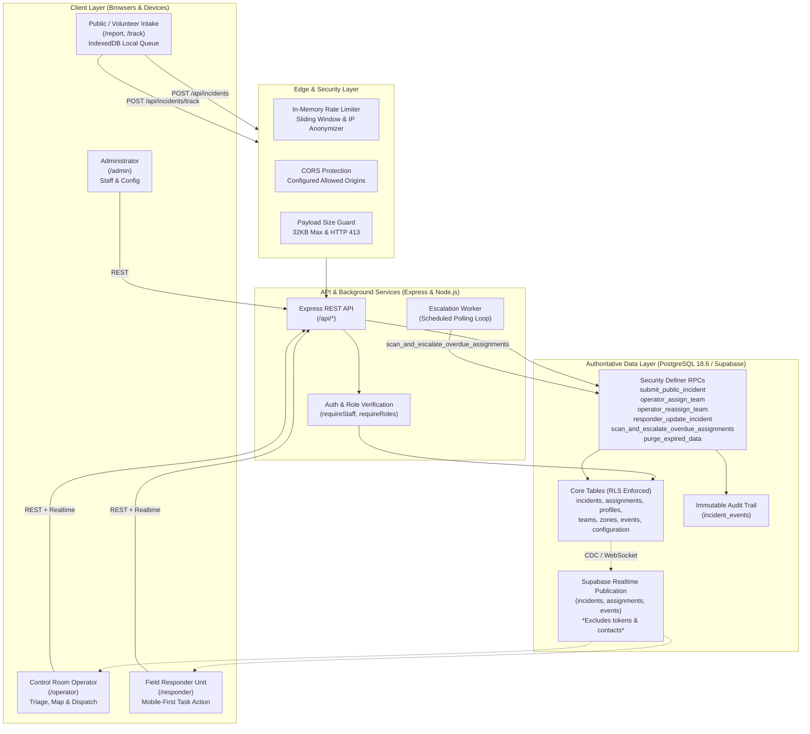

# System Architecture

## Overview

The Godavari Pushkaralu Emergency Response Coordination System is a software-only prototype designed to explore reliable intake, operator triage, dispatch allocation, missed-acknowledgement escalation, and public tracking during large-scale festival gatherings.

---

## Subsystem Boundaries

### 1. Public Visitor Intake & Local Queue

- **Routes:** `/report`, `/track`
- **Resilience:** Unsent emergency drafts are written to client-side IndexedDB (`godavari_emergency_queue_v1`) with transparent memory fallback. Retries reuse the client-generated `clientRequestId` to reconcile lost acknowledgements idempotently without duplicate records.
- **Privacy:** Form contact details and tokens are never broadcast via Realtime sockets or exposed in server URL query parameters. Tokens are hashed with SHA-256 before storage.

### 2. Control Room Operator Workspace

- **Route:** `/operator`
- **Capabilities:** Incident queue inspection, manual vs GPS veracity auditing, zone-based candidate team recommendation, atomic team assignment, missed-acknowledgement escalation monitoring, operator-directed team reassignment, and final incident closure.
- **Views:** Three-way split toggle between Queue Only, Map Only, and Split View (Queue + Leaflet Map).

### 3. Field Responder Interface

- **Route:** `/responder`
- **Capabilities:** Mobile-first, single-incident focus displaying assigned incident category, location coordinates/landmark, report age, and tactical notes.
- **State Progression:** Sequential transition execution (`ACKNOWLEDGE` → `EN_ROUTE` → `ON_SCENE` → `RESOLVE`). Allows requesting support with mandatory notes and marks resolution with documented release of team availability.

### 4. Background Escalation Worker

- **Process:** Scheduled daemon service (`EscalationWorker` in `apps/api/src/workers/escalation-worker.ts`).
- **Function:** Periodically executes PostgreSQL stored procedure `public.scan_and_escalate_overdue_assignments()`. Detects unacknowledged assignments past deadline and appends an `ACKNOWLEDGEMENT_OVERDUE` event. Completely decoupled from browser sessions and recovers immediately upon worker process restart.

### 5. PostgreSQL Authoritative Storage & RLS

- **Database Engine:** PostgreSQL 18.6 with Row-Level Security (RLS) enabled on all tables.
- **Privilege Partitioning:** Direct client table writes are barred; state mutations run exclusively through `SECURITY DEFINER` stored procedures granted to `service_role`. Anonymous and public execution privileges on privileged procedures are revoked.
