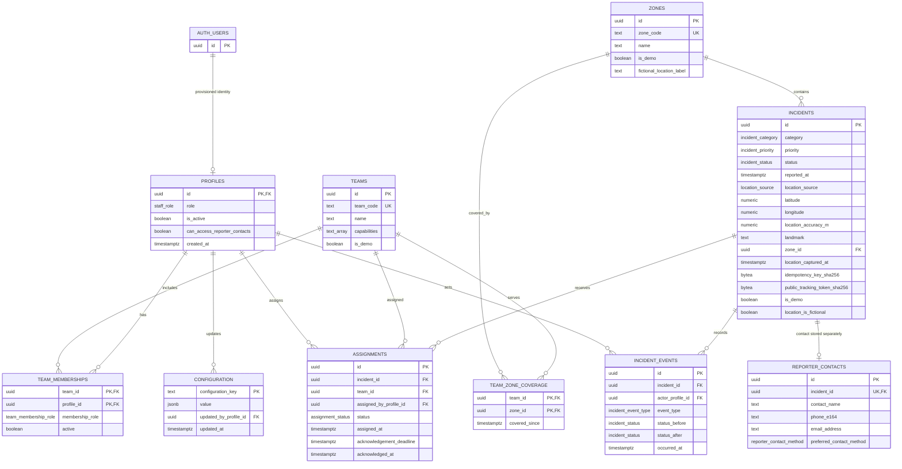

# Stage 2–3 entity-relationship diagram

All relationships below are protected by PostgreSQL foreign keys. The diagram is text-based Mermaid and can be reviewed without an image renderer.

`AUTH_USERS` is Supabase's existing `auth.users` relation, not a table created or seeded by this repository. `TEAM_ZONE_COVERAGE` is an additional normalized table that makes each team's service zones referenceable and foreign-key checked. A reporter's name, phone, and email exist only in `REPORTER_CONTACTS`, not on `INCIDENTS`. Public idempotency and tracking values have digest columns only; the raw values are never persisted.

## Stage 3 authorization note

Stage 3 adds `profiles.is_active` and the explicit `profiles.can_access_reporter_contacts` permission. No new public staff table or self-registration relationship is created. Operators are scoped to operational incidents; responders are scoped through active `TEAM_MEMBERSHIPS` and active `ASSIGNMENTS`; administrator role alone does not grant incident access. Reporter contacts require both the explicit profile permission and access to the related incident. Profile and team-membership writes are guarded against self-targeting.
